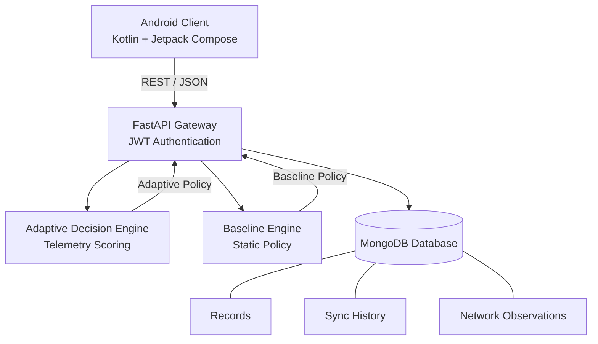

# Adaptive Offline Data Synchronization Backend

**FastAPI + MongoDB backend for ADAS (Adaptive Offline Data Synchronization Framework).**

The backend provides an offline-first synchronization infrastructure designed for intermittent network environments. It integrates with an Android client and implements two deterministic synchronization engines: an adaptive rule-based decision engine (`adaptive_decision_engine`) and a static comparison engine (`baseline_engine`) for empirical benchmarking.

## Features

- **JWT Authentication:** User registration, login, and bearer token verification.
- **Offline-First Record Ingestion:** Authenticated field-record storage and retrieval with idempotent submissions using client-generated UUIDs (`client_record_id`).
- **Conflict Detection & Resolution:** Version-aware duplicate and divergence detection with explicit conflict resolution strategies (`server_wins` / `client_wins`).
- **Adaptive Decision Engine:** Evaluates device and network telemetry to recommend immediate, partial, or delayed synchronization.
- **Static Baseline Engine:** Implements a fixed synchronization policy for controlled comparative benchmarking.
- **Bounded Batch Execution:** Enforces batch limits during synchronization execution.
- **Synchronization Observability:** Records synchronization attempts, network observations, and aggregated performance statistics in MongoDB.

## System Architecture



### Technology Stack

| Component | Technology |
|---|---|
| Backend Framework | FastAPI |
| Programming Language | Python 3.11+ |
| Database | MongoDB |
| Authentication | JWT |
| API Documentation | Swagger UI / OpenAPI |
| ASGI Server | Uvicorn |
| Android Client | Kotlin, Jetpack Compose |
| Local Storage | Room / SQLite |
| Background Synchronization | WorkManager |
| HTTP Client | Retrofit |

## Synchronization Workflow

The system follows an offline-first synchronization workflow:

1. **Offline Capture:** The Android application stores field records locally using Room (SQLite). Each record receives a stable, client-generated `client_record_id` UUID.
2. **Connectivity Detection:** WorkManager monitors network availability and initiates synchronization when connectivity is detected.
3. **Policy Evaluation:** The client submits queued records and current device/network telemetry to `POST /api/v1/sync/decision`.
4. **Adaptive Decision:** The backend evaluates the telemetry and returns a synchronization policy:
   - `immediate` – Synchronize queued records immediately.
   - `partial` – Synchronize a bounded subset of queued records.
   - `delayed` – Defer synchronization until more suitable conditions are available.
5. **Bounded Execution:** The client submits an eligible batch to `POST /api/v1/sync/execute`.
6. **Conflict Handling:** The backend checks record identifiers and versions, persists accepted records, and flags conflicting submissions.
7. **Telemetry Logging:** Synchronization outcomes and network conditions are persisted for subsequent evaluation.

## Decision Engines

### 1. Adaptive Decision Engine (`adaptive_decision_engine`)

Mathematical, rule-based engine that evaluates network and device telemetry to determine an appropriate synchronization strategy.

**Input parameters:**

| Parameter | Description |
|---|---|
| `signal_strength` | Current network signal strength |
| `bandwidth_kbps` | Available network bandwidth |
| `latency_ms` | Network response latency |
| `battery_percent` | Remaining device battery |
| `data_budget_kb` | Available data allocation |

The engine uses predefined thresholds and weighted telemetry scoring to balance synchronization throughput, connection stability, data availability, and battery preservation.

The deterministic approach avoids runtime machine learning overhead, cold-start training requirements, and unpredictable inference latency.

### 2. Static Baseline Engine (`baseline_engine`)

Implements a non-adaptive comparison strategy.

The baseline attempts immediate full-queue synchronization whenever network connectivity is available, without considering:

- Signal quality.
- Network latency.
- Available bandwidth.
- Battery level.
- Data budget constraints.

### 3. Comparative Benchmarking

Both engines share a unified input/output interface, allowing identical network conditions and synchronization workloads to be evaluated under different policies.

The resulting execution history and aggregated metrics support empirical comparison of:

- Synchronization completion rate.
- Synchronization latency.
- Data transfer volume.
- Synchronization success and failure rates.

This enables an experimental comparison between adaptive synchronization and conventional periodic/immediate synchronization approaches.

## API Endpoints

All authenticated endpoints require a valid JWT bearer token.

### Authentication

| Method | Endpoint | Description |
|---|---|---|
| POST | `/api/v1/auth/register` | Register a new user account |
| POST | `/api/v1/auth/login` | Authenticate and obtain a JWT |
| GET | `/api/v1/auth/me` | Retrieve authenticated user profile |

### Field Records

| Method | Endpoint | Description |
|---|---|---|
| POST | `/api/v1/records` | Store a single field record |
| GET | `/api/v1/records` | Retrieve user-owned records |
| GET | `/api/v1/records/{record_id}` | Retrieve a specific record |
| POST | `/api/v1/records/{record_id}/resolve` | Resolve a record conflict |

### Synchronization

| Method | Endpoint | Description |
|---|---|---|
| POST | `/api/v1/sync/decision` | Evaluate telemetry and return a synchronization policy |
| POST | `/api/v1/sync/execute` | Execute a bounded synchronization batch |
| GET | `/api/v1/sync/history` | Retrieve synchronization attempt history |
| GET | `/api/v1/sync/stats` | Retrieve aggregated synchronization metrics |

### Network Observations

| Method | Endpoint | Description |
|---|---|---|
| POST | `/api/v1/network/observations` | Log a network condition snapshot |
| GET | `/api/v1/network/observations` | Retrieve network observations |

### System Health

| Method | Endpoint | Description |
|---|---|---|
| GET | `/health` | Check backend service health |

## Requirements

- Python 3.11 or later
- MongoDB Community Server (local installation) or MongoDB Atlas
- pip (Python package manager)

## Local Setup & Execution

### 1. Clone the Repository

```bash
git clone <YOUR_REPOSITORY_URL>
cd <YOUR_PROJECT_DIRECTORY>
```

### 2. Create and Activate a Virtual Environment

```bash
python -m venv .venv
```

**Windows PowerShell:**

```powershell
.venv\Scripts\Activate.ps1
```

**macOS / Linux:**

```bash
source .venv/bin/activate
```

### 3. Install Dependencies

```bash
pip install -r requirements.txt
```

### 4. Configure Environment Variables

Create a `.env` file in the project root using `.env.example` as a template.

```env
MONGODB_URI=mongodb://localhost:27017
DATABASE_NAME=adas_sync
JWT_SECRET_KEY=replace-with-a-strong-random-secret
```

Ensure that MongoDB is running or that your MongoDB Atlas connection string is correctly configured.

### 5. Start the Backend Server

```bash
uvicorn app.main:app --reload
```

The API will be available at:

```text
http://127.0.0.1:8000
```

### 6. Access API Documentation

FastAPI automatically generates interactive API documentation.

- **Swagger UI:** http://127.0.0.1:8000/docs
- **ReDoc:** http://127.0.0.1:8000/redoc

## Authentication Flow

The API uses JWT-based authentication to protect user-specific records and synchronization operations.

1. Register an account using `POST /api/v1/auth/register`.
2. Authenticate using `POST /api/v1/auth/login`.
3. Retrieve the returned `access_token`.
4. Include the token in subsequent authenticated requests.

**Authorization header:**

```http
Authorization: Bearer <access_token>
```

For Swagger UI, use the **Authorize** button to provide your bearer token.

The login endpoint accepts form fields:

| Field | Description |
|---|---|
| `username` | Registered email address |
| `password` | Account password |

## Example Synchronization Request

The following JSON illustrates the telemetry and queued-record structure used during synchronization decision evaluation and execution.

```json
{
  "records": [
    {
      "client_record_id": "550e8400-e29b-41d4-a716-446655440000",
      "data": {
        "site": "Station A",
        "observation": "Telemetry sample recorded",
        "notes": "Captured during intermittent cellular coverage"
      },
      "version": 1
    }
  ],
  "network_type": "cellular",
  "signal_strength": 72,
  "bandwidth_kbps": 850,
  "latency_ms": 180,
  "battery_percent": 68,
  "data_budget_kb": 500
}
```

## Database Structure

The backend uses MongoDB to persist user data, field records, and synchronization telemetry.

| Collection | Purpose |
|---|---|
| `users` | Registered user accounts and authentication data |
| `records` | Persisted field records |
| `sync_history` | Synchronization attempts and execution outcomes |
| `network_observations` | Historical network condition measurements |

## Idempotency & Conflict Resolution

The system implements mechanisms to ensure reliable record submission despite intermittent connectivity and repeated synchronization attempts.

### Idempotent Submissions

- Each Android client generates a unique `client_record_id` UUID.
- Retrying an identical payload with the same identifier is safely acknowledged.
- Submitting modified data under an existing identifier triggers conflict detection.

### Conflict Resolution Strategies

| Strategy | Behaviour |
|---|---|
| `server_wins` | Retains the existing server-side record |
| `client_wins` | Accepts the incoming client-side version |

Explicit conflict resolution prevents silent overwriting of divergent field records.

## Prototype Scope & Limitations

This implementation is an academic research and systems prototype intended to evaluate adaptive synchronization under intermittent network conditions.

Current design considerations include:

- Deterministic rule-based synchronization decisions.
- Controlled comparison against a static baseline.
- Idempotent record ingestion.
- Version-aware conflict detection and resolution.
- Bounded synchronization batch execution.
- Persistent network and synchronization telemetry.

**Production deployment considerations:**

Before production deployment, additional security and reliability measures should be implemented:

- Enforce HTTPS/TLS termination.
- Implement API rate limiting.
- Introduce role-based access control (RBAC).
- Enable multi-document MongoDB transactions where required.
- Implement stronger operational monitoring and error reporting.
- Secure environment variables and JWT signing secrets.

## Research Context

This backend forms part of the **Adaptive Offline Data Synchronization Framework (ADAS)** research project.

The research investigates whether adaptive synchronization strategies can improve consistency and synchronization success rates compared to conventional periodic synchronization approaches in low-connectivity environments in Kenya.

By comparing a telemetry-driven adaptive engine against a static baseline using identical network conditions and workloads, the system provides an experimental foundation for evaluating synchronization performance under constrained connectivity.

---

**Project:** Adaptive Offline Data Synchronization Framework (ADAS)  
**Backend:** FastAPI + MongoDB  
**Client:** Android (Kotlin + Jetpack Compose)  
**Architecture:** Offline-first, REST-based synchronization  
**Purpose:** Academic research and empirical benchmarking
